<picture>
  <source media="(prefers-color-scheme: dark) and (prefers-reduced-motion: reduce)" srcset="hero-dark-still.svg">
  <source media="(prefers-color-scheme: dark)" srcset="hero-dark.svg">
  <source media="(prefers-reduced-motion: reduce)" srcset="hero-light-still.svg">
  
</picture>

## Kerem Özdemir

Sustainability and economics, read in parallel at the Technical University of
Munich and Istanbul University.

Everything here is published with its method and its limits. Every number here is meant to be checked.

The tools run in a browser at **[keremozdemir.de](https://keremozdemir.de)**,
next to the case studies behind them and the source of every figure.

### Results

On Zenodo since 2026-10-26, CC BY 4.0:

| | |
|---|---|
| [Covering designs](https://doi.org/10.5281/zenodo.23666421) | New upper bounds for 27 covering numbers C(v,k,t), four of them exact, such as C(63,11,2) = 41 |
| [Schur number S(7)](https://doi.org/10.5281/zenodo.23670664) | A sum-free 7-colouring of {1, ..., 1698}: S(7) ≥ 1698, up from 1696, and R_7(3) ≥ 1700 |
| [Covering code K(20,3)](https://doi.org/10.5281/zenodo.23670398) | 1917 codewords, against 2048 in the published tables |
| [Circle packings](https://doi.org/10.5281/zenodo.23668593) | Larger certified radii for 164, 182, 193, 255 and 284 equal circles in the isosceles right triangle |
| [Cayley graphs of diameter 2](https://doi.org/10.5281/zenodo.23668463) | Degrees 18, 19, 20, 22 and 27, each larger than the Cayley-graph entry of the degree-diameter table |
| [Conjecture 20 of Chen, Guo, Li and Wang](https://doi.org/10.5281/zenodo.23669060) | A counterexample: the split graph of the Fano plane, n = 14, k = 6 |
| [Two conjectures of Li and Guo](https://doi.org/10.5281/zenodo.23669770) | Two statements that fail as printed, one of them at the 5-cycle |

Submitted 2026-10-26 and awaiting review: C_1c ≥ 0.4103454241 and C_1d ≤ 1.4556234448,
from exact step-function [certificates](https://github.com/Keremozdemirra/tao-1c-1d-certificates),
as [a pull request](https://github.com/teorth/optimizationproblems/pull/271) to Terence Tao's optimization problems repository.

All were found and checked with Claude (Anthropic) under Kerem Özdemir's
direction. Zenodo records are self-archived, without peer review.

### EU sustainability rules, as MCP servers

Each runs as a command line and as an MCP server, on the Python standard library alone.

| | |
|---|---|
| [csrd-scope](https://github.com/Keremozdemirra/csrd-scope) | Is an undertaking in CSRD scope after the 2026 Omnibus, and from which financial year, with the article behind each step |
| [vsme-kit](https://github.com/Keremozdemirra/vsme-kit) | The VSME standard for SMEs as quotable text, and a check that a filled EFRAG Digital Template is complete and adds up |
| [cbam-mcp](https://github.com/Keremozdemirra/cbam-mcp) | CBAM scope, default values by country of origin and CN descriptions, with the binding act and data version on every answer |
| [eu-taxonomy-mcp](https://github.com/Keremozdemirra/eu-taxonomy-mcp) | EU Taxonomy activities by NACE code, with the screening and DNSH criteria per objective, from a dated Navigator snapshot |
| [eu-ets-mcp](https://github.com/Keremozdemirra/eu-ets-mcp) | Union Registry data by installation, LEI, country or sector: verified emissions, free allocation, surrendered units |
| [eudr-scope-mcp](https://github.com/Keremozdemirra/eudr-scope-mcp) | EUDR Annex I by CN code, application dates and country risk, including amendments EUR-Lex has not consolidated yet |
| [financed-emissions](https://github.com/Keremozdemirra/financed-emissions) | Scope 3 category 15 for the ten PCAF Part A asset classes, with the formula and the page of the standard for every position |

### Analysis and research

| | |
|---|---|
| [esg-toolkit](https://github.com/Keremozdemirra/esg-toolkit) | Carbon decomposition, target pathways, abatement cost, CBAM embedded emissions |
| [analyst-toolkit](https://github.com/Keremozdemirra/analyst-toolkit) | Market sizing from two directions, and a discounted cash flow with the terminal value taken apart |
| [open-climate-data](https://github.com/Keremozdemirra/open-climate-data) | Public climate, energy and emissions datasets, every value carrying its source, version and date |
| [unitguard](https://github.com/Keremozdemirra/unitguard) | Unit and dimension safety for energy and emissions arithmetic. It refuses when the units do not line up |
| [xlsx-review](https://github.com/Keremozdemirra/xlsx-review) | A formula-level diff of two Excel workbooks, with the edits that usually break models marked |
| [simea](https://github.com/Keremozdemirra/simea) | Research on agency in multi-agent systems, published as written findings |

### Guards for coding agents

| | |
|---|---|
| [agent-vitals](https://github.com/Keremozdemirra/agent-vitals) | A daily census of the AI agent tooling ecosystem: what is still maintained, what carries a licence, what went quiet |
| [pkg-vitals](https://github.com/Keremozdemirra/pkg-vitals) | Checks an npm or PyPI package before an agent installs it: does the name exist, is it brand new, deprecated or yanked |
| [mcp-upkeep](https://github.com/Keremozdemirra/mcp-upkeep) | Checks whether the repository behind each MCP server you run is still maintained, licensed and pinned |
| [destroy-guard](https://github.com/Keremozdemirra/destroy-guard) | A Claude Code hook: `terraform destroy`, `kubectl delete`, `helm uninstall` and `git push --force` wait for a verified backup |
| [credential-reach](https://github.com/Keremozdemirra/credential-reach) | Lists the credentials an agent running as you could use, without printing one |
| [awesome-vitals](https://github.com/Keremozdemirra/awesome-vitals) | Finds the archived, renamed, abandoned and unlicensed repositories in a Markdown list, with the line of each |

Twelve further repositories hold the working method as skill packs, one per
trade. Eight are prose: the method written down, in Markdown. Four carry a
small Python helper alongside it. All twelve are MIT, and none of them takes a
dependency it has not earned.

[chess-glasses](https://github.com/Keremozdemirra/chess-glasses) is a voice chess
coach for camera glasses without a display: the glasses video-call a Mac, Claude
reads the board, and Stockfish's move is spoken into your ear.

Header wind data: <a href="https://open-meteo.com">Open-Meteo</a>, CC BY 4.0.
